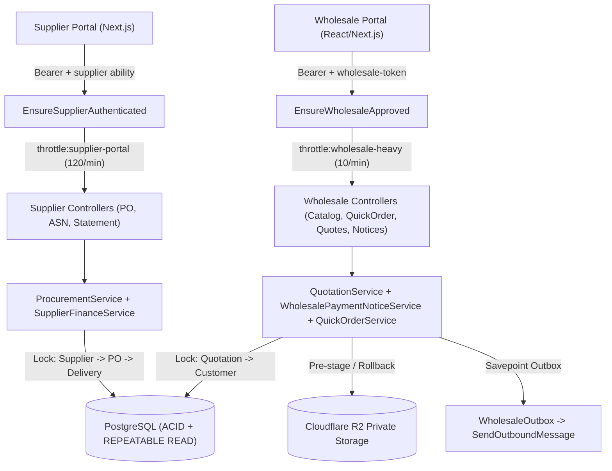
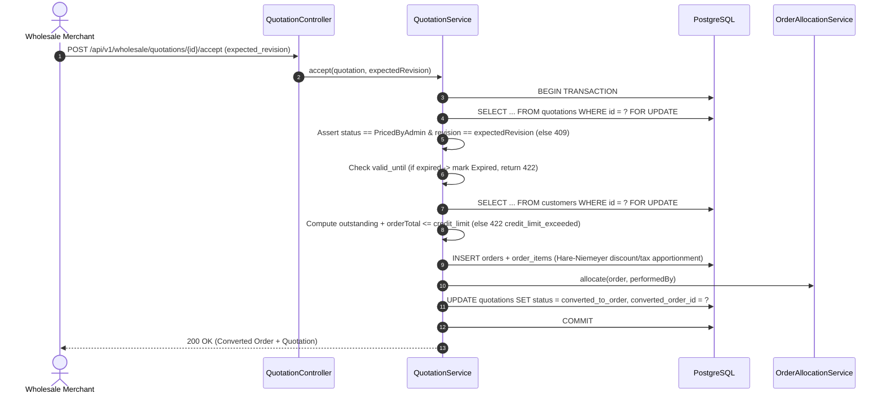

# Supplier & Wholesale Portal — Architectural Deep Dive & Diligence Report

> **Classification:** Technical Due Diligence & Engineering Documentation  
> **Target Audience:** Technical Evaluators, Software Buyers, Chief Technology Officers, Enterprise Solution Architects  
> **Status:** Published (Audited against Laravel 11 Backend, PostgreSQL, Cloudflare R2, and React/Next.js Portal)  
> **Evidence Tier:** `Verified` (Implemented in Production Code + Automated Frontend & Backend Suites; see Section 8 for exact observed pass/fail counts)  
> **Primary Source References:**  
> - Supplier Portal Routes & Controllers:  
>   - [`bags-platform/backend/routes/api/supplier.php`](file:///d:/programming/programming/projects/alfarid/bags-platform/backend/routes/api/supplier.php)  
>   - [`bags-platform/backend/app/Http/Middleware/EnsureSupplierAuthenticated.php`](file:///d:/programming/programming/projects/alfarid/bags-platform/backend/app/Http/Middleware/EnsureSupplierAuthenticated.php)  
>   - [`bags-platform/backend/app/Http/Controllers/Api/V1/Supplier/PurchaseOrderController.php`](file:///d:/programming/programming/projects/alfarid/bags-platform/backend/app/Http/Controllers/Api/V1/Supplier/PurchaseOrderController.php)  
>   - [`bags-platform/backend/app/Http/Controllers/Api/V1/Supplier/DeliveryController.php`](file:///d:/programming/programming/projects/alfarid/bags-platform/backend/app/Http/Controllers/Api/V1/Supplier/DeliveryController.php)  
>   - [`bags-platform/backend/app/Http/Controllers/Api/V1/Supplier/AccountController.php`](file:///d:/programming/programming/projects/alfarid/bags-platform/backend/app/Http/Controllers/Api/V1/Supplier/AccountController.php)  
>   - [`bags-platform/backend/app/Http/Controllers/Api/V1/Supplier/DashboardController.php`](file:///d:/programming/programming/projects/alfarid/bags-platform/backend/app/Http/Controllers/Api/V1/Supplier/DashboardController.php)  
> - Procurement & Supplier Finance Services:  
>   - [`bags-platform/backend/app/Services/Procurement/ProcurementService.php`](file:///d:/programming/programming/projects/alfarid/bags-platform/backend/app/Services/Procurement/ProcurementService.php)  
>   - [`bags-platform/backend/app/Services/Procurement/SupplierFinanceService.php`](file:///d:/programming/programming/projects/alfarid/bags-platform/backend/app/Services/Procurement/SupplierFinanceService.php)  
>   - [`bags-platform/backend/app/Services/Procurement/SupplierService.php`](file:///d:/programming/programming/projects/alfarid/bags-platform/backend/app/Services/Procurement/SupplierService.php)  
> - Wholesale Portal Routes & Controllers:  
>   - [`bags-platform/backend/routes/api/wholesale.php`](file:///d:/programming/programming/projects/alfarid/bags-platform/backend/routes/api/wholesale.php)  
>   - [`bags-platform/backend/app/Http/Middleware/EnsureWholesaleApproved.php`](file:///d:/programming/programming/projects/alfarid/bags-platform/backend/app/Http/Middleware/EnsureWholesaleApproved.php)  
>   - [`bags-platform/backend/app/Http/Controllers/Api/V1/Wholesale/RegisterController.php`](file:///d:/programming/programming/projects/alfarid/bags-platform/backend/app/Http/Controllers/Api/V1/Wholesale/RegisterController.php)  
>   - [`bags-platform/backend/app/Http/Controllers/Api/V1/Wholesale/ProductController.php`](file:///d:/programming/programming/projects/alfarid/bags-platform/backend/app/Http/Controllers/Api/V1/Wholesale/ProductController.php)  
>   - [`bags-platform/backend/app/Http/Controllers/Api/V1/Wholesale/QuickOrderController.php`](file:///d:/programming/programming/projects/alfarid/bags-platform/backend/app/Http/Controllers/Api/V1/Wholesale/QuickOrderController.php)  
>   - [`bags-platform/backend/app/Http/Controllers/Api/V1/Wholesale/QuotationController.php`](file:///d:/programming/programming/projects/alfarid/bags-platform/backend/app/Http/Controllers/Api/V1/Wholesale/QuotationController.php)  
>   - [`bags-platform/backend/app/Http/Controllers/Api/V1/Wholesale/PaymentNoticeController.php`](file:///d:/programming/programming/projects/alfarid/bags-platform/backend/app/Http/Controllers/Api/V1/Wholesale/PaymentNoticeController.php)  
> - Wholesale Domain Services:  
>   - [`bags-platform/backend/app/Services/Wholesale/WholesaleRegistrationService.php`](file:///d:/programming/programming/projects/alfarid/bags-platform/backend/app/Services/Wholesale/WholesaleRegistrationService.php)  
>   - [`bags-platform/backend/app/Services/Wholesale/WholesaleQuickOrderService.php`](file:///d:/programming/programming/projects/alfarid/bags-platform/backend/app/Services/Wholesale/WholesaleQuickOrderService.php)  
>   - [`bags-platform/backend/app/Services/Wholesale/QuotationService.php`](file:///d:/programming/programming/projects/alfarid/bags-platform/backend/app/Services/Wholesale/QuotationService.php)  
>   - [`bags-platform/backend/app/Services/Wholesale/WholesalePaymentNoticeService.php`](file:///d:/programming/programming/projects/alfarid/bags-platform/backend/app/Services/Wholesale/WholesalePaymentNoticeService.php)  
>   - [`bags-platform/backend/app/Services/Wholesale/WholesaleOrderBalanceQuery.php`](file:///d:/programming/programming/projects/alfarid/bags-platform/backend/app/Services/Wholesale/WholesaleOrderBalanceQuery.php)  
>   - [`bags-platform/backend/app/Services/Wholesale/WholesaleOutbox.php`](file:///d:/programming/programming/projects/alfarid/bags-platform/backend/app/Services/Wholesale/WholesaleOutbox.php)  
> - Rate Limiters & Frontend Clients:  
>   - [`bags-platform/backend/app/Providers/AppServiceProvider.php`](file:///d:/programming/programming/projects/alfarid/bags-platform/backend/app/Providers/AppServiceProvider.php#L619-L729)  
>   - [`bags-platform/frontend/packages/api-client/src/endpoints/supplier.ts`](file:///d:/programming/programming/projects/alfarid/bags-platform/frontend/packages/api-client/src/endpoints/supplier.ts)  
>   - [`bags-platform/frontend/packages/api-client/src/endpoints/wholesale.ts`](file:///d:/programming/programming/projects/alfarid/bags-platform/frontend/packages/api-client/src/endpoints/wholesale.ts)  
>   - [`bags-platform/frontend/packages/ui/src/wholesale-portal/WholesalePortal.jsx`](file:///d:/programming/programming/projects/alfarid/bags-platform/frontend/packages/ui/src/wholesale-portal/WholesalePortal.jsx)  
> **Primary Test References:**  
> - Frontend Wholesale Portal Tests: [`wholesale-portal.test.cjs`](file:///d:/programming/programming/projects/alfarid/bags-platform/frontend/tests/wholesale-portal.test.cjs), [`wholesale-portal-slice5.test.cjs`](file:///d:/programming/programming/projects/alfarid/bags-platform/frontend/tests/wholesale-portal-slice5.test.cjs)  
> - Backend Procurement & Supplier Suites: [`bags-platform/backend/tests/Feature/Procurement/`](file:///d:/programming/programming/projects/alfarid/bags-platform/backend/tests/Feature/Procurement)  
> - Backend Wholesale Suites: [`bags-platform/backend/tests/Feature/Wholesale/`](file:///d:/programming/programming/projects/alfarid/bags-platform/backend/tests/Feature/Wholesale)

---

## 1. Executive Summary & Value Proposition

The **Supplier & Wholesale Portal Subsystem** powers both sides of the B2B supply chain in Alfarid / Bags-Platform: **upstream vendor procurement** (purchase order acceptance, Advance Shipping Notices, invoice ceiling enforcement, and vendor ledger statements) and **downstream wholesale merchant commerce** (KYB trade onboarding, tiered B2B pricing, 500-line spreadsheet quick-ordering, versioned price quotations, credit-limit exposure enforcement, and bank-transfer payment notice reconciliation).

- **Core Capability:** `[IMPLEMENTED]` Isolates external B2B actors into dedicated guard-scoped API surfaces (`/api/v1/supplier/*` and `/api/v1/wholesale/*`) with strict tenant scoping, deterministic database locking, and arbitrary-precision `BigDecimal` financial accounting.
- **Architectural Philosophy:** `[IMPLEMENTED]` Defense-in-depth multi-tenant isolation combined with pessimistic row locking (`SELECT ... FOR UPDATE`), canonical lock ordering (`Supplier -> PurchaseOrder`), transactional object-storage rollback (`PrivateAttachments::transaction`), and a savepoint-guarded transactional outbox (`WholesaleOutbox`).
- **Commercial Impact:** Eliminates B2B credit-limit bypasses, prevents duplicate supplier shipments and forged bank-transfer receipts, and automates bulk merchant ordering (up to 500 SKUs per batch) without exposing PHP-FPM workers to N+1 query storms or unbounded file uploads.
- **Operational Resilience:** `[IMPLEMENTED]` Heavy B2B operations (PDF/Excel price list exports, spreadsheet imports, invoice PDFs, payment receipt uploads) are isolated behind dedicated `wholesale-heavy` (10 req/min) rate-limit buckets, while supplier statements execute inside PostgreSQL `REPEATABLE READ READ ONLY` snapshots.

---

## 2. The Engineering Challenge

B2B portals fail differently from consumer storefronts because transactions involve **large batch payloads, multi-party credit exposure, asynchronous bank transfers, and concurrent back-office vs. portal mutations**:

- **Credit-Limit & Double-Accept Races:** If a wholesale merchant clicks "Accept Quotation" twice concurrently—or accepts a quotation while the back-office admin is updating its unit prices—an unlocked implementation either creates two credit orders exceeding the merchant's credit limit or binds the merchant to stale prices.
- **Procurement Deadlocks & Over-Receipt:** Back-office finance operations lock `Supplier -> PurchaseOrder` while warehouse intake locks `PurchaseOrder -> Supplier`. Without a canonical lock hierarchy, concurrent invoice posting and ASN submission deadlock in PostgreSQL (`40P01`).
- **Duplicate & Forged Payment Proofs:** Wholesale buyers settle credit invoices via manual bank transfers. Without cryptographic file hashing and cross-customer reference checks, the same bank receipt PDF or reference number can be submitted twice or across accounts to inflate credit capacity.
- **Spreadsheet & Export Worker Exhaustion:** B2B buyers upload 500-row Excel/CSV sheets and export full catalog PDFs. Unbounded requests or N+1 pricing queries saturate PHP-FPM worker pools and starve retail checkout traffic.

---

## 3. Architectural Design & System Components

### Component Breakdown

| Component / Layer | Implementation Path | Responsibility | Architectural Pattern |
|---|---|---|---|
| **Supplier Auth & Parent Gate** | [`EnsureSupplierAuthenticated.php`](file:///d:/programming/programming/projects/alfarid/bags-platform/backend/app/Http/Middleware/EnsureSupplierAuthenticated.php) | Enforces Bearer `PersonalAccessToken` with `supplier` ability, active `SupplierUser`, and active parent `Supplier` | Dual-Entity Guard Middleware |
| **Wholesale Channel Gate** | [`EnsureWholesaleApproved.php`](file:///d:/programming/programming/projects/alfarid/bags-platform/backend/app/Http/Middleware/EnsureWholesaleApproved.php) | Verifies `Customer::isWholesaleApproved()` and channel-scoped token (`wholesale-token` / `wholesale`) | Channel-Isolated Auth Middleware |
| **Procurement & ASN Engine** | [`ProcurementService.php`](file:///d:/programming/programming/projects/alfarid/bags-platform/backend/app/Services/Procurement/ProcurementService.php) | PO lifecycle, supplier accept/change-request, idempotent ASN creation, cumulative shipped qty caps | Canonical Lock Hierarchy + Idempotency |
| **Supplier Finance & Snapshot** | [`SupplierFinanceService.php`](file:///d:/programming/programming/projects/alfarid/bags-platform/backend/app/Services/Procurement/SupplierFinanceService.php) | Invoice ceiling enforcement, payment voiding, `REPEATABLE READ` ledger statements | Snapshot Isolation + `BigDecimal` |
| **Supplier Account Lifecycle** | [`SupplierService.php`](file:///d:/programming/programming/projects/alfarid/bags-platform/backend/app/Services/Procurement/SupplierService.php) | Opening balance immutability and immediate token revocation on supplier deactivation | Row-Locked Session Purge |
| **KYB Onboarding & Pre-Alloc** | [`WholesaleRegistrationService.php`](file:///d:/programming/programming/projects/alfarid/bags-platform/backend/app/Services/Wholesale/WholesaleRegistrationService.php) | Pre-allocates PostgreSQL sequence ID for R2 document staging prior to DB transaction | Pre-Allocated ID + Compensation Purge |
| **Bulk Quick-Order Engine** | [`WholesaleQuickOrderService.php`](file:///d:/programming/programming/projects/alfarid/bags-platform/backend/app/Services/Wholesale/WholesaleQuickOrderService.php) | Batch SKU/barcode lookup (up to 500 lines), tiered pricing preload, Excel/CSV cart import | Batch Preload + `CartService` Delegation |
| **Quotation Lifecycle Engine** | [`QuotationService.php`](file:///d:/programming/programming/projects/alfarid/bags-platform/backend/app/Services/Wholesale/QuotationService.php) | Draft/Submit/Price/Accept/Expire state machine, revision conflict check, credit-limit gate | Optimistic Revision + Pessimistic Lock |
| **Payment Notice & FIFO Engine** | [`WholesalePaymentNoticeService.php`](file:///d:/programming/programming/projects/alfarid/bags-platform/backend/app/Services/Wholesale/WholesalePaymentNoticeService.php) | 3-layer receipt deduplication, `PrivateAttachments` rollback, FIFO credit allocation | Transactional Upload + `BigDecimal` |
| **SQL Order Balance Subquery** | [`WholesaleOrderBalanceQuery.php`](file:///d:/programming/programming/projects/alfarid/bags-platform/backend/app/Services/Wholesale/WholesaleOrderBalanceQuery.php) | Computes net unpaid credit order balances minus approved notices, allocations, and credit notes | Scoped Derived-Table Join |
| **Notification Outbox** | [`WholesaleOutbox.php`](file:///d:/programming/programming/projects/alfarid/bags-platform/backend/app/Services/Wholesale/WholesaleOutbox.php) | Savepoint-guarded idempotent outbox with WhatsApp opt-in and business-hours deferral | Transactional Outbox Pattern |

### System Architecture Diagram

---

## 4. Internal Execution Flow & Lifecycle

### A. Wholesale Quotation Acceptance & Credit Exposure Gate (`QuotationService::accept`)

### Step-by-Step Flow Description

1. **Ingress & Channel Isolation:** `EnsureWholesaleApproved` (`EnsureWholesaleApproved.php#L19-L58`) verifies that the caller is an approved `Customer` *and* holds a `PersonalAccessToken` with `wholesale-token` or `wholesale` ability—blocking retail tokens even on wholesale-approved accounts.
2. **Concurrency & Revision Check:** `QuotationService::accept` (`QuotationService.php#L295-L314`) acquires `SELECT ... FOR UPDATE` on the quotation row, verifies `QuotationStatus::PricedByAdmin`, and enforces `$expectedRevision` (returning HTTP `409` `quotation_revision_conflict` if an admin repriced the quote concurrently).
3. **Credit-Limit Serialization:** The service locks the `Customer` row (`QuotationService.php#L336`), sums current exposure via `WholesalePaymentNoticeService::outstandingBalanceDecimal($customer)`, and rejects the conversion with `credit_limit_exceeded` (`422`) if `outstanding + orderTotal > credit_limit` (`QuotationService.php#L345-L355`).
4. **Penny-Exact Apportionment & Allocation:** Header discounts and taxes are distributed across order lines via `ProportionalDistribution::distribute` (`QuotationService.php#L383-L398`), followed by immediate physical inventory reservation (`OrderAllocationService::allocate`) and outbox email queuing (`CustomerEmailOutbox::orderReceived`).

---

## 5. Critical Engineering Discoveries & Decision Log

### Discovery 1: Canonical Lock Hierarchy (`Supplier -> PurchaseOrder -> Deliveries`)
- **The Problem:** Concurrent supplier ASN submissions, warehouse receipts, and supplier invoice postings touch both `suppliers` and `purchase_orders` tables. Acquiring locks in opposite orders (`PO -> Supplier` vs. `Supplier -> PO`) causes PostgreSQL deadlocks (`40P01`).
- **Naive Alternative & Why It Fails:** Locking only `PurchaseOrder` allows concurrent supplier balance updates or supplier deactivation to race; locking in arbitrary order causes deadlocks under load.
- **Actual Implementation:** `ProcurementService::lockSupplierThenOrder` (`ProcurementService.php#L641-L650`) and `closeDeliveryShort` (`ProcurementService.php#L567-L571`) enforce a strict `Supplier -> PurchaseOrder -> Deliveries` lock acquisition order, re-locking if `supplier_id` changed mid-flight.
- **Defensible Advantage:** Eliminates cross-service deadlocks between procurement intake and vendor finance operations.
- **Trade-offs:** Serializes concurrent mutations on the same supplier, which is appropriate for B2B vendor ledgers.

### Discovery 2: 3-Layer Payment Notice Deduplication & Transactional R2 Rollback
- **The Problem:** Wholesale buyers submit bank-transfer payment notices with uploaded receipt files. Retries, double-clicks, or fraud attempts can submit the same bank reference or receipt image multiple times, or leave orphaned files in Cloudflare R2 if validation fails.
- **Naive Alternative & Why It Fails:** Checking only `reference_number` per customer misses cross-account receipt reuse; storing files before DB validation leaks orphaned objects on `409`/`422` errors.
- **Actual Implementation:** `WholesalePaymentNoticeService::create` (`WholesalePaymentNoticeService.php#L53-L124`) locks the `Customer` row and enforces three checks: (1) per-customer active `reference_number` uniqueness, (2) cross-customer `(reference_number, amount, transfer_date)` collision detection, and (3) binary `hash_file('sha256', ...)` (`receipt_sha256`) uniqueness backed by a DB unique constraint. The entire operation runs inside `PrivateAttachments::transaction(...)` so any failure automatically deletes the uploaded R2 object.
- **Defensible Advantage:** Neutralizes duplicate credit claims and prevents cloud storage leaks on rejected submissions.
- **Trade-offs:** Requires computing SHA-256 on the uploaded receipt file before DB insertion.

### Discovery 3: Pre-Allocated Sequence IDs for KYB Onboarding Uploads
- **The Problem:** Wholesale registration accepts multiple KYB trade documents (`tax_number`, `commercial_register`, attachments). Uploading to R2 *inside* a DB transaction holds database connections and locks open during slow external network I/O; uploading *before* knowing the `customer_id` requires costly S3/R2 object copy-and-delete moves afterward.
- **Naive Alternative & Why It Fails:** Moving objects in R2 after `INSERT` adds latency and partial-failure states; holding DB transactions open during R2 uploads exhausts PgBouncer pools.
- **Actual Implementation:** `WholesaleRegistrationService::register` (`WholesaleRegistrationService.php#L69-L106`) pre-allocates the PostgreSQL sequence ID via `SELECT nextval(pg_get_serial_sequence('customers', 'id'))`, streams documents directly to `customer_documents/{$customerId}` on R2 *before* opening the DB transaction, and calls `purgeUploadedPaths($storedPaths)` if the subsequent transaction fails.
- **Defensible Advantage:** Zero R2 move operations and zero network I/O inside PostgreSQL transactions.
- **Trade-offs:** Failed registrations leave a harmless gap in the `customers.id` sequence.

### Discovery 4: `REPEATABLE READ READ ONLY` Supplier Statements
- **The Problem:** Generating a supplier account statement reads `opening_balance`, posted invoices, active payments, and voided payments across multiple queries. Under `READ COMMITTED`, a concurrent invoice posting or payment void mid-query produces an inconsistent running balance.
- **Naive Alternative & Why It Fails:** `READ COMMITTED` allows non-repeatable reads; `LOCK TABLE` blocks all procurement writes.
- **Actual Implementation:** `SupplierFinanceService::statement` (`SupplierFinanceService.php#L718-L754`) opens a top-level `SET TRANSACTION ISOLATION LEVEL REPEATABLE READ READ ONLY` snapshot on PostgreSQL (when `DB::transactionLevel() === 0`), bounds the query window to `<= 366` days, and computes running balances with `Brick\Math\BigDecimal` at scale 2.
- **Defensible Advantage:** Zero-lock, mathematically consistent point-in-time vendor statements.
- **Trade-offs:** Only activates when `statement()` owns the outermost transaction (`DB::transactionLevel() === 0`); nested callers inherit the outer transaction's isolation level.

### Discovery 5: Savepoint-Guarded Idempotent Outbox (`WholesaleOutbox`)
- **The Problem:** Wholesale order and payment events queue outbound WhatsApp/SMS notifications from inside service transactions. On PostgreSQL, catching a `UniqueConstraintViolationException` on a duplicate `idempotency_key` without a savepoint aborts the entire outer transaction (`25P02`).
- **Naive Alternative & Why It Fails:** A bare `try { OutboundMessage::create(...); } catch (UniqueConstraintViolationException)` poisons the outer PostgreSQL transaction and rolls back the business operation.
- **Actual Implementation:** `WholesaleOutbox::queue` (`WholesaleOutbox.php#L31-L67`) wraps `OutboundMessage::create` in a nested `DB::transaction(...)` (creating a PostgreSQL `SAVEPOINT`), silently drops duplicate idempotency keys, enforces `whatsapp_opt_in_at !== null`, and defers `SendOutboundMessage::dispatch(...)->afterCommit()` to the merchant's `preferred_contact_hours` window.
- **Defensible Advantage:** Guarantees at-most-once notification enqueueing without ever aborting parent financial transactions.
- **Trade-offs:** Adds one savepoint per queued outbound message inside transactions.

---

## 6. Performance, Concurrency & Data Integrity

### Concurrency Guarantees
- **Supplier ASN Idempotency & Cumulative Caps:** `ProcurementService::createSupplierDelivery` (`ProcurementService.php#L959-L1019`) hashes the uploaded invoice file (`sha256`), executes inside `OperationIdempotencyService::run('supplier_delivery', ...)`, and locks `PurchaseOrderItem` + pending `SupplierDeliveryItem` rows to enforce `received_qty + pending_shipped_qty + current_shipped_qty <= ordered_qty`.
- **Supplier Deactivation Session Purge:** `SupplierService::update` (`SupplierService.php#L61-L69`) locks all `SupplierUser` rows (`lockForUpdate()`) and deletes their `personal_access_tokens` inside the same transaction when `is_active` transitions to `false`.
- **Credit Balance Subquery:** `WholesaleOrderBalanceQuery::unpaidCreditOrderBalances` (`WholesaleOrderBalanceQuery.php#L25-L58`) computes per-order remaining debt in SQL (`GREATEST(grand_total - linked_notices - approved_allocations - credit_notes, 0)`) with `Order` global scopes applied.

### Query & Rate-Limit Isolation
- **Batch Pricing Preload:** Both `ProductController::index` (`ProductController.php#L81-L92`) and `WholesaleQuickOrderService::lookupLines` (`WholesaleQuickOrderService.php#L62-L67`) batch-fetch active-branch `StockLevel` availability and call `$this->pricing->contextFor($customer, $variantIds)` once per page/batch instead of per variant.
- **Tiered Rate Limiting (`AppServiceProvider.php`):**
  - `supplier-login`: `5/min` + `30/hour` per normalized email + `120/min` per `/64`-normalized IP (`L619-L633`).
  - `supplier-portal`: `120/min` per `supplier:{id}` or network IP (`L713-L714`).
  - `wholesale-heavy`: `10/min` per `customer:{id}` + route name for price-list exports, spreadsheet imports, invoice PDFs, and payment notice uploads (`L724-L729`).

---

## 7. Security, Validation & Defense-in-Depth

- **Cross-Tenant Enumeration Prevention:** Every supplier query in `PurchaseOrderController` (`PurchaseOrderController.php#L88-L92`) and `DeliveryController` (`DeliveryController.php#L34-L82`) filters by `where('supplier_id', $user->supplier_id)` and excludes `draft` purchase orders, returning `404` on foreign IDs.
- **Executable File Signature Rejection:** Both `RegisterController::uploadDocument` (`RegisterController.php#L97`) and `QuickOrderController::import` (`QuickOrderController.php#L69`) enforce `RejectExecutableSignature` alongside strict MIME/extension allowlists and 5 MiB size limits.
- **Channel Token Isolation:** `EnsureSupplierAuthenticated` rejects stateful `TransientToken`s and requires the `supplier` ability; `EnsureWholesaleApproved` rejects retail-scoped tokens even for approved wholesale customers.
- **Frontend Hardening:** `wholesale-portal.test.cjs` and `wholesale-portal-slice5.test.cjs` verify positive safe-integer portal IDs, Cairo-timezone calendar boundaries, server-authoritative totals (no client price derivation), and `expected_revision` propagation on quotation acceptance.

---

## 8. Empirical Verification & Test Matrix

| Test Suite / File | Test Scope | Tested Invariants / Scenarios | Status |
|---|---|---|---|
| `frontend/tests/wholesale-portal.test.cjs` & `wholesale-portal-slice5.test.cjs` | Frontend Unit & Hardening | 25 assertions: `expected_revision` on `acceptQuote`, idempotency key retention on checkout retries, Cairo date boundaries, server-authoritative totals, F-17 hardening guards | `Passing (25/25)` |
| `backend/tests/Feature/Procurement/` | Backend Feature (14 files, 103 tests) | Supplier portal scoping, ASN idempotency, invoice ceiling enforcement, payment void race, `REPEATABLE READ` statement, branch/active guards | `98/103 Passing (5 failed; 929 assertions)` |
| `backend/tests/Feature/Wholesale/` | Backend Feature (65+ files, 362 tests) | KYB registration, quotation accept race, credit-limit gate, 3-layer payment notice dedup, FIFO settlement, quick-order import, outbox & rate limits | `303/362 Passing (35 failed, 24 errors; 1314 assertions)` |

> **Audit Evidence Citation (Observed Runs):**
> - Frontend Test Command: `Set-Location bags-platform/frontend; node --test tests/wholesale-portal.test.cjs tests/wholesale-portal-slice5.test.cjs` — observed `25/25` passing (`0` failed, `0` skipped).
> - Backend Procurement Command: `Set-Location bags-platform/backend; php artisan test tests/Feature/Procurement` — observed `98/103` passing (`5` failures: `SupplierPortalTest::test_statement_running_balance_math` returning `409`, `TaskTxtProcurementActiveStateTest` maker-checker `422`, `TaskTxtProcurementGapsTest` 2 assertions, `TaskTxtSupplierReferenceReuseTest` `410` vs `422`).
> - Backend Wholesale Command: `Set-Location bags-platform/backend; php artisan test tests/Feature/Wholesale` — observed `303/362` passing (`35` failures, `24` errors; primary error clusters: `SentryTelemetry.php:117` expecting `Sentry\Scope` instead of `Sentry\State\Scope` in `CatalogRetailPriceObserver`, and missing `wholesale_reference_identity(character varying)` SQL function in `alfarid_testing`).

---

## 9. Commercial Advantage & Acquisition Value (The Buyer Lens)

1. **Zero-Leakage B2B Credit & Vendor Accounting:** Arbitrary-precision `BigDecimal` math, `REPEATABLE READ` vendor statements, and row-locked credit-limit checks eliminate the financial reconciliation bugs that plague custom B2B builds.
2. **Fraud-Resistant Payment & KYB Pipelines:** 3-layer receipt deduplication (`reference_number` + cross-customer tuple + `receipt_sha256`) and executable-signature upload guards protect accounts receivable and cloud storage budgets out of the box.
3. **High-Throughput B2B Ordering:** 500-line SKU/barcode quick-order lookups and Excel/CSV imports with preloaded pricing contexts and `wholesale-heavy` rate-limit isolation let large wholesale buyers order at scale without degrading retail checkout latency.
4. **Clean Multi-Tenant Guard Separation:** Strict token ability scoping (`supplier` vs. `wholesale-token` vs. retail) prevents lateral privilege escalation across portals.

---

## 10. Engineering Trade-offs & Known Boundaries

- **PostgreSQL-Specific Concurrency Primitives:** `SET TRANSACTION ISOLATION LEVEL REPEATABLE READ READ ONLY` (`SupplierFinanceService.php#L728-L729`) and `nextval(pg_get_serial_sequence(...))` (`WholesaleRegistrationService.php#L70-L71`) are PostgreSQL-specific (with SQLite/MySQL fallbacks for non-pgsql drivers in tests).
- **Synchronous Heavy Exports:** Price-list PDF/Excel exports and invoice PDFs execute synchronously behind the `wholesale-heavy` (`10/min`) rate limiter; at 10x catalog size (>10,000 SKUs), moving exports to queued background jobs with signed R2 download links is recommended.
- **Observed Integration Drift in Test Runs:** In the `Wholesale` PHPUnit suite, `SentryTelemetry.php#L117` threw a `TypeError` (`Sentry\Scope` vs `Sentry\State\Scope`) during `CatalogRetailPriceObserver` hooks, and `alfarid_testing` lacked the PostgreSQL `wholesale_reference_identity(character varying)` function for notice deduplication tests. Resolving these two items is recommended before next CI release.
